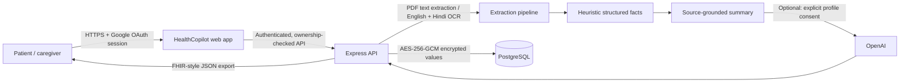

# HealthCopilot — submission notes

## Challenge fit

HealthCopilot collects prescriptions, lab reports, discharge summaries, and diagnostic documents into family-profile timelines. It extracts record dates, common lab measurements and medicine-like lines; gives cautious plain-language summaries; and provides English/Hindi OCR and summaries. Users can review trends, search records, prepare for clinician visits, manage reminders, print a report, and export a FHIR-style bundle. Google OAuth and per-profile ownership checks scope private records. User-provided manual entry is available when OCR is poor.

## Architecture

Original files and clinical text are encrypted at application level before PostgreSQL persistence. The encryption key is held in the server environment, not in the database. Google identity is stored separately. Every health API checks ownership by joining the selected profile to the signed-in account. `audit_events` records key user operations without recording clinical text.

## Demo sequence (3–4 minutes)

Use a fictional profile and a synthetic sample lab report/prescription.

1. Sign in with a configured Google test account; show the private workspace and family-profile switcher.
2. Upload a synthetic lab report image/PDF; show OCR completion, extracted values, printed reference ranges, and the verification disclaimer.
3. Open the summary; point out source-reported flags and that they are not a diagnosis. Add a second dated synthetic result and show trends/timeline.
4. Ask the Health Agent: “Which glucose results are in my records?” Show that it cites record dates and asks the user to verify with a clinician. Optionally enable external AI consent and repeat in Hindi.
5. Show the medication-pattern checker disclaimer, print summary, and download the FHIR-style bundle.
6. Close with the boundaries: heuristic extraction, limited interaction patterns, mock ABHA field, no clinical/ABDM certification.

## Data model summary

| Table | Purpose |
| --- | --- |
| `app_users` | Google account identity |
| `family_profiles` | Owner-scoped patient/caregiver profiles and mock ABHA field |
| `profile_state` | Encrypted preferences, medicine list, reminders and chat history |
| `health_documents` | Encrypted source file, OCR text, structured facts and summary |
| `medicine_reminders` | Relational reminder schema for future scheduling integration |
| `audit_events` | Account/profile action log |

## Demo deployment checklist

- Configure Google OAuth origin and callback to match the Render service URL exactly.
- Verify `/healthz` returns `{"ok":true}` after schema deployment.
- Upload only synthetic records; check extraction manually before presenting.
- Keep external AI off unless the judge demo specifically requires it and the profile user consents.
- The free Render PostgreSQL instance is temporary (30 days) and has no backups. Use a paid durable database before regular use.

